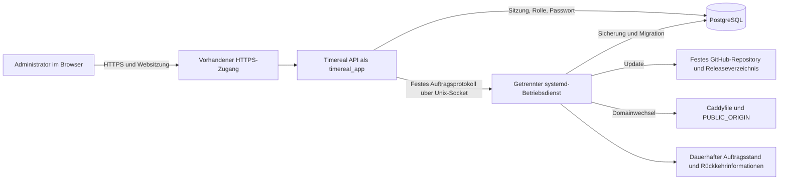

# Timereal 0.7.0 — Betrieb im Adminbereich

**Implementierungsstand 0.7.0 vom 19. November 2026.** Grundlage: veröffentlichte Version 0.6.2, Commit `2e287287df539c8465567f2b9c95ddfb937100e1`. Der Auftrag umfasst Updates und die Einrichtung einer öffentlichen Domain in der Verwaltung. Lars hat die Bildvorlagen für Updates und Domainzugriff einschließlich Fortschritt und Zugriffsbestätigung mit „Bildentwürfe freigeben (empfohlen)“ zur Umsetzung freigegeben. Die bereits abgenommenen Verwaltungs- und Footerbilder bleiben der Gestaltungsmaßstab. Die Implementierung und ihre tatsächlich ausgeführten Prüfungen sind im [Auslieferungsnachweis](nachweise/0.7.0.md) getrennt von offenen Messungen dokumentiert.

## Bedienung

**Ergänzung 0.7.2:** „Status aktualisieren“ unter Updates umgeht den Versionscache und fragt GitHub neu ab. Das Ergebnis steht anschließend auch dem Footer zur Verfügung. Die Prüfung ist auf einen Versuch je Minute pro Serverprozess begrenzt; gesperrte oder widerrufene Sitzungen, Berater und Erweiterungssitzungen können sie nicht auslösen. Eine abgeschaltete Versionsprüfung bleibt abgeschaltet. Vor 0.7.2 liest der Knopf nur den bisherigen Cache; der einmalige Übergang ist in der [Betriebsanleitung](betrieb/README.md#versionsfooter-und-updateprüfung-ab-062) beschrieben.

Unter **Verwaltung** stehen die Bereiche **Berater**, **Updates** und **Domainzugriff**. Persönliche Einstellungen bleiben unter Einstellungen. Betriebsaktionen sind für Administratoren vorgesehen.

### Updates

1. Installierte und neu verfügbare stabile Version anzeigen; Änderungsnotizen öffnen. Ein Abruffehler heißt „Prüfung derzeit nicht möglich“, nicht „Aktuell“.
2. **Update vorbereiten** lädt das konkrete Release und baut es in einem eigenen Verzeichnis. Die Anwendung bleibt in dieser Phase nutzbar. Rechte, Speicherplatz und Versions-/Schemakompatibilität werden geprüft. Ein Konflikt mit einer anderen Betriebsaktion wird angezeigt.
3. Nach erfolgreicher Vorbereitung zeigt die Oberfläche das festgehaltene Versionsziel. **Sichern und installieren** erfordert das aktuelle Administratorpasswort. Der Hinweis erklärt die kurze Unterbrechung für angemeldete Nutzer; laufende Timer behalten ihre zeitlichen Grenzen in PostgreSQL.
4. Der getrennte Betriebsdienst hält die Anwendung an, erstellt und prüft die Sicherung, migriert, schaltet das Release um und startet die Anwendung. Der Fortschritt zeigt echte Phasen ohne erfundene Prozentwerte.
5. Während des Neustarts meldet die Oberfläche den vorübergehenden Verbindungsverlust und verbindet sich erneut. Browser schließen oder Seite neu laden startet keinen zweiten Auftrag. Ein erfolgreich gestarteter Auftrag läuft unabhängig vom Browser weiter.
6. Ergebnis mit Ausgangs-/Zielversion, Zeitpunkt und veranlassendem Konto anzeigen. Bei fehlgeschlagener Aktivierung wird zwischen „vorige Anwendung wieder erreichbar“ und „manuelle Wiederherstellung erforderlich“ unterschieden. Kein automatisches Zurückspielen eines alten Datenbankdumps.

### Domainwechsel

1. **Verwaltung → Domainzugriff** zeigt die tatsächlich konfigurierte öffentliche Adresse und das erkannte Proxy-Ziel. Die Domain wird ohne Protokoll oder Pfad eingetragen. Keine Festverdrahtung auf Lars' Domain.
2. **Domain prüfen** validiert Namen und vorhandene Caddy-Konfiguration. Vorhandene Konfiguration muss einer unterstützten Vorlage entsprechen; eigene Änderungen werden nicht überschrieben. Containeradresse und Port werden aus dem Bestand abgeleitet, nicht als beliebige Netzwerkziele vom Browser übernommen.
3. Angezeigt wird, was der Betreiber am externen Proxy benötigt: HTTPS-Ziel samt Port, öffentlicher Host-Header und gültiges öffentliches Zertifikat. Timereal richtet keine fremden DNS-/Router-/Nginx-Konten ein. Eine lokale Probe wird nicht als externer Erreichbarkeitsnachweis ausgegeben.
4. **Domain übernehmen** erfordert das aktuelle Administratorpasswort. Der Betriebsdienst sichert Caddy-Konfiguration und `PUBLIC_ORIGIN`, übernimmt beide gemeinsam und prüft echte HTTPS-Antworten einschließlich nichtleerer Startseite und korrekter Health-Antwort.
5. Die Oberfläche öffnet die neue Adresse. Dort meldet sich der Administrator erneut an und wählt **Zugriff bestätigen**. Die Sitzung wird nicht zwischen Domains übertragen. Bestätigen ist nur über die neue konfigurierte Origin zulässig.
6. Wird der Zugriff innerhalb von drei Minuten nach erfolgreichem lokalen Neustart nicht bestätigt, stellt der Betriebsdienst die vorherige Konfiguration wieder her. Das gilt auch bei geschlossenem Browser. Ein Neustart des Betriebsdienstes erkennt abgelaufene Fristen aus dem dauerhaft gespeicherten Auftrag. Die alte Adresse und die verbleibende Bestätigungsfrist bleiben im Wechselbild sichtbar.

Der erste Umfang unterstützt den vorhandenen Timereal-LXC mit externem HTTPS-Proxy und lokaler IPv4-Adresse auf Port 443. Abweichende eigene Caddy-Konfigurationen werden als nicht unterstützt angezeigt. Ein neuer öffentlicher Direktbetrieb ohne vorgeschalteten Proxy bleibt über das bestehende HTTPS-Einrichtungsskript möglich und wird nicht still in einen anderen Betriebsmodus umgeschaltet.

## Architektur und Vertrauensgrenzen

- Die Web-App bleibt `timereal_app`, mit `NoNewPrivileges=true`, ohne sudo und ohne Schreibrechte an Systemkonfiguration oder Releasecode.
- Der neue Dienst verwendet einen lokalen Unix-Socket mit ausdrücklich gesetztem Modus `0660`, Besitzer root und Gruppe `timereal_app`. Verzeichnis und Dienstprogramm sind root-eigen und für die Web-App nicht beschreibbar. Kein zusätzlicher TCP-Port und keine direkte öffentliche Weiterleitung zum Dienst.
- Das Protokoll erlaubt nur vorbereiten, starten, Status lesen, Domain prüfen/übernehmen/bestätigen. Kein frei wählbarer Shellbefehl, Dateipfad, Git-Remote oder Umgebungsblock. Prozesse starten mit festen Argumenten und ohne Shellinterpolation.
- Die API bindet eine gültige Websitzung und prüft `admin_pruefen()`. Erweiterungs-Bearer, Berater, gesperrte Konten und widerrufene Sitzungen erhalten keinen Zugriff. Schreibzugriffe unterliegen der Origin-Prüfung; Passwortprüfungen werden begrenzt. Rollen und Sitzung werden bei jeder Aktion erneut geprüft.
- Das Socketrecht ist eine bewusste Vertrauensgrenze: Ein vollständig übernommener Webprozess könnte erlaubte Betriebsaufträge anfordern. Deshalb begrenzt der Betriebsdienst selbst Quelle, Ziel, Übergänge und Argumente; er ist keine zweite unabhängige Benutzeranmeldung. Das Restrisiko wird nicht als vollständige Prozessisolation ausgegeben.
- Releasequelle bleibt `larsborgwardt/timereal`. Nur stabile semantische Versionen, kein Downgrade; Git-Tag und Commit werden bei Vorbereitung festgehalten und vor Aktivierung erneut verglichen. TLS und das Repository sind die Vertrauensbasis; ohne zusätzlichen Signaturvertrag wird keine Signaturprüfung behauptet.
- Ein gemeinsamer Betriebslock verhindert gleichzeitige Webupdates, Domainwechsel und Konsoleneingriffe. Wiederholungen mit demselben Auftragsschlüssel liefern denselben Auftrag; abweichende Nutzdaten zum selben Schlüssel werden abgewiesen.

## Auftrags- und API-Vertrag

Implementierte Endpunkte; bis auf die reine Versionsprüfung muss der Unix-Betriebsdienst eingerichtet sein:

| Endpunkt unter `/api/v1/verwaltung/betrieb` | Zweck |
|---|---|
| `GET /status` | Betriebsdienst erreichbar, aktuelle Konfiguration, jüngster Auftrag |
| `POST /updates/pruefen` | Ab 0.7.2: Administrator-Websitzung, Origin-Prüfung, leeres JSON-Objekt; sofortige Versionsprüfung ohne root-Aktion; bei erneutem Versuch innerhalb einer Minute HTTP 429 mit `Retry-After` |
| `POST /updates/vorbereiten` | Festes stabiles Release prüfen und separat bauen; Auftragsschlüssel |
| `POST /updates/:id/installieren` | Bestätigtes Ziel aktivieren; aktuelles Passwort und Auftragsschlüssel |
| `POST /domain/pruefen` | Domain gegen Konfiguration prüfen; unveränderlichen Prüfvorgang erzeugen |
| `POST /domain/:id/uebernehmen` | Geprüfte Konfiguration nach Passwortprüfung anwenden |
| `POST /domain/:id/bestaetigen` | Neuen Zugriff als Administrator über die neue Origin bestätigen |
| `POST /domain/:id/zuruecknehmen` | Noch unbestätigten Wechsel auf die gesicherte Konfiguration zurücknehmen |
| `GET /auftraege/:id` | Persistierten Fortschritt und begrenzten Ergebnisbericht lesen |

Aufträge haben UUID, Typ, Konto-ID, Ausgangs-/Zielstand, Auftragsschlüssel, Konfigurationsfingerabdruck, Zustand, Phase und Zeitpunkte. Für den Domainwechsel kommen Bestätigungsfrist und Referenz auf die gesicherte Konfiguration hinzu. Passwörter, Cookies und SMTP-Zugangsdaten werden nicht in den Auftrag geschrieben. Statusausgaben enthalten keine rohen Prozesslogs oder beliebigen Dateiinhalte.

Der root-eigene Zustandsbestand liegt unter `/var/lib/timereal-betrieb`. Austausch erfolgt atomar mit Datei- und Verzeichnissynchronisation. Ein erfolgreicher HTTP-Start antwortet erst nach dauerhafter Annahme mit `202` und Auftrags-ID. Scheitert die Zustellung an den Betriebsdienst, zeigt die API einen Fehler. Prozessausgabe wird nicht als Statusprotokoll geparst; Betriebsskripte erhalten strukturierte Phasen-/Ergebnisereignisse.

Updatezustände: `vorbereitung`, `bereit`, `sicherung`, `migration`, `neustart`, `erfolgreich`, `fehlgeschlagen`, `vorherige_version_aktiv`, `wiederherstellung_noetig`. Domainzustände: `geprueft`, `uebernahme`, `bestaetigung_ausstehend`, `erfolgreich`, `zurueckgesetzt`, `wiederherstellung_noetig`. Nach einem Dienst-/Hostneustart wird der tatsächlich aktive Stand geprüft, bevor ein terminales Ergebnis festgeschrieben wird. Ein unterbrochener Auftrag wird nicht blind erneut ausgeführt.

Der Betriebsdienst liegt außerhalb des aktiven App-Releasezeigers. Seine eigene Aktualisierung überlebt den gerade laufenden Auftrag: neuer Dienststand wird separat installiert, vorheriger bleibt für Rückkehr verfügbar; erst nach dauerhaftem Ergebnis wird der Dienst neu gestartet. `release.json` bindet Webupdates an `betriebProtokoll: 1` und `apiVersion: 1`. Ein inkompatibles Release wird mit einem Hinweis auf den Konsolenweg abgewiesen. Nach einem Abbruch während des Dienstwechsels wird auch der Hilfsdienst nachgezogen, bevor die Wiederherstellung als erfolgreich endet. Folgesprung und Abbruchfall wurden mit privaten Prüftags ausgeführt, nicht mit vorweg veröffentlichten Releases.

Aufträge und Wiederholungsschlüssel werden nicht automatisch gelöscht. Bei den Grenzen von 2.000 Aufträgen beziehungsweise 10.000 Schlüsseln verweigert der Dienst neue Aufträge und verlangt Wartung. Die Zahlen sind Begrenzungen des Auftragsbuchs, keine Aufbewahrungsfrist. Sicherungen unter `/var/lib/timereal-betrieb/sicherungen` können vertrauliche Konfiguration enthalten und bleiben root-eigen. Speicherverbrauch und Sicherung dieses Bestands gehören zum Containerbetrieb.

## Lieferfolge und Prüfungen

1. Bildfreigabe; danach Betriebsdienst und HTTP-Vertrag mit zuerst roten Verhaltenstests bauen.
2. Webupdate einschließlich Vorbereitung, erneuter Passwortprüfung, Idempotenz und Neustart verbinden.
3. Domainzugriff mit echtem Caddy/TLS, neuer Anmeldung, Bestätigung und fristgesteuertem Rückbau verbinden.
4. Erstinstallation und Bootstrap aus 0.6.2 sowie Folgesprung im eigenen Debian-13/systemd-Prüfgast ausführen. Der Testgast ist getrennt von Lars' LXC.
5. Gegen das freigegebene Bild auf Laptop und Smartphone prüfen; Links, Tastatur, Fehler, Verbindungsverlust und 200 % Textgröße einschließen. Release erst nach grüner Prüfung veröffentlichen.

Die tatsächlich ausgeführten API-, Browser-, Zustands- und Debian-Betriebsproben stehen mit Befehlen und Ergebnissen im [Auslieferungsnachweis](nachweise/0.7.0.md). Eine Browserprobe mit ersetztem privilegiertem Betriebsschritt misst die Bedienung; die getrennte native Probe misst echte Dienste, PostgreSQL, TLS, Git und Rückbau. Das wird nicht als gemeinsamer Ende-zu-Ende-Browserlauf auf Proxmox ausgegeben. Zusätzliche Störungsproben für Speicherknappheit, Sicherungsfehler und einen ebenfalls nicht mehr startbaren Vorgänger bleiben offen; Lars' externer Proxy wurde nicht verändert oder als funktionsfähig abgenommen.

**Einmaliger Umstieg:** Ein Container mit 0.6.2 enthält den Betriebsdienst noch nicht. Lars installiert 0.7.0 zunächst einmal über die Konsole; dabei werden die root-eigenen Dateien und systemd-Einheiten eingerichtet. Anschließend sind reguläre Updates und unterstützte Domainwechsel über die Verwaltung möglich. Bei nicht mehr erreichbarer Anwendung bleibt die Konsole ein Wiederherstellungsweg.

## Bilder und Quellen

Die [HTML-Vorlage](mockups/10-admin-betrieb.html) zeigt illustrative Zustände, keine ausgeführten Betriebsaktionen. Versionswerte, Adressen und Prüfergebnisse in den Bildern sind Beispieldaten. Die Anwendung selbst wird damit nicht verändert.

- [Updates am Laptop](mockups/10-updates-desktop.png)
- [Domainzugriff am Laptop](mockups/10-domain-desktop.png)
- [Domainzugriff am Smartphone](mockups/10-domain-mobil.png)
- [Neustart während eines Updates](mockups/10-update-neustart.png)
- [Bestätigung der neuen Domain](mockups/10-domain-bestaetigen.png)

Technische Referenzen: [systemd.socket, SocketMode/SocketGroup](https://www.freedesktop.org/software/systemd/man/latest/systemd.socket.html), [Node.js 24, child_process](https://nodejs.org/docs/latest-v24.x/api/child_process.html). Vorhandene Integrationspunkte: `betrieb/update.sh`, `betrieb/proxy-einrichten.sh`, `betrieb/timereal.service`, `src/app.ts`, `src/konten-routen.ts`, `src/session.ts`.
