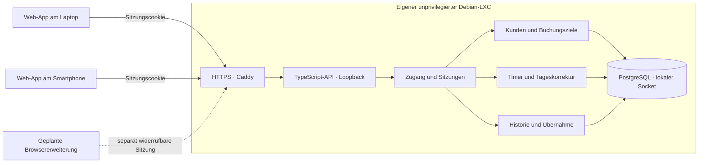
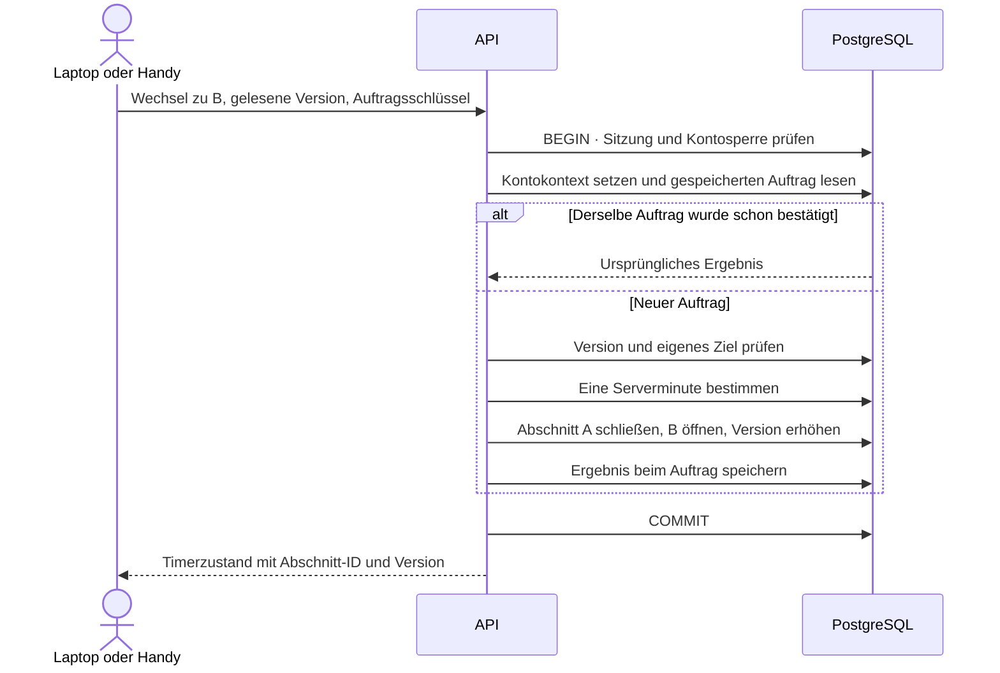

# Architektur von Timereal

Die Web-App läuft auf einem eigenen Linux-Systemcontainer. Für den Pilot sind Backend und Datenbank getrennte Prozesse im selben Gast. Das Backend ist ein modularer Monolith in TypeScript mit Node.js und Fastify. Lern- und Wartungsaufwand bleiben überschaubar, weil ein Kundenwechsel in einer einzigen PostgreSQL-Transaktion abgeschlossen wird.

## Zuständigkeiten und Vertrauensgrenzen

| Stelle | Aufgabe |
|---|---|
| Oberfläche | Zeigt den vom Server gelesenen Zustand. Die laufende Anzeige berechnet sie aus der Startzeit. Datenbankkennung des Benutzers und Wechselzeit sind keine Eingaben des Clients. |
| Zugang | Das Passwort wird mit Salt und scrypt geprüft. Der Browser erhält ein zufälliges Sitzungstoken als HttpOnly-, Secure- und SameSite-Cookie. PostgreSQL speichert seinen SHA-256-Abdruck, Clientart, Ablauf und Widerruf. Änderungen über Cookie verlangen die konfigurierte HTTPS-Herkunft. |
| Servertransaktion | Prüft und sperrt das Konto und die Sitzung. Sie bindet die Konto-ID nur für diese Transaktion. Fehler rollen die Änderung zurück, bevor die Verbindung in den Pool zurückkehrt. |
| Fachmodule | Kundenanlage und Projektzuordnung liegen bei den Buchungszielen. Der Timer setzt Zeitgrenzen. Die Tageskorrektur bearbeitet bestehende Abschnitte. Die Nachweise berechnen den Übertragungsstand aus denselben Daten. |
| PostgreSQL | Die Dienstrolle besitzt keine Tabellen und hat keine RLS-Ausnahme. Eigentümerbezogene Fremdschlüssel, Zeilenrichtlinien und ein Ausschluss über Zeitintervalle sichern die Schreib- und Lesewege. Migration und Kontoverwaltung erfolgen mit eigener Berechtigung. |
| Betrieb | Der Webdienst lauscht auf Loopback. Die Datenbank nutzt Peer-Anmeldung am lokalen Socket. Der HTTPS-Dienst besitzt ein eigenes Betriebssystemkonto für die Test-CA. Der Installer richtet einen Zugang im Testnetz ein. |

## Einen Kunden wechseln

Der Client sendet beispielsweise `POST /api/v1/timer/wechsel`, den Header `Idempotency-Key` mit einer UUID und den JSON-Inhalt `{"version":"1","art":"zugeordnet","zielId":"42"}`. Ein Wechsel darf ein neues Buchungsziel einschließlich Kundenanlage im selben Auftrag enthalten. Scheitert der Wechsel, bleibt das vorherige Ziel aktiv und die Anlage wird zurückgerollt.

Ein konkurrierendes Gerät mit eigener UUID und derselben alten Version erhält HTTP 409. Es lädt mit `GET /api/v1/timer` den aktuellen Zustand. Eine verloren gegangene Antwort kann mit identischem Auftrag und identischer UUID erneut abgefragt werden, selbst wenn der Timer inzwischen weitergelaufen ist. Derselbe Schlüssel mit verändertem Inhalt ergibt 409. Ein fremdes Buchungsziel ergibt 404. Eine widerrufene Sitzung ergibt 401. Lesezugriffe anderer Konten sperren einander fachlich nicht.

## Timervertrag für beide Oberflächen

| Auftrag unter `/api/v1/timer/` | Vorher | Wirkung |
|---|---|---|
| `start` | Frei oder pausiert | Öffnet einen Abschnitt für das gewählte Ziel. Löst eine vorhandene Pause auf. |
| `wechsel` | Läuft | Schließt den bisherigen und eröffnet den neuen Abschnitt an derselben Grenze. |
| `pause` | Läuft | Schließt den Abschnitt und merkt dessen ID im Konto. Die Pause erzeugt keine Arbeitszeit. |
| `fortsetzen` | Pausiert | Beginnt einen eigenen Abschnitt für das vorgemerkte Ziel. |
| `stopp` | Läuft oder pausiert | Beendet die Messung und entfernt die Vormerkung. Ein späterer Start bleibt möglich. |

Für Notizen gilt `PATCH /api/v1/abschnitte/{id}/notiz` mit Leistungstext und gelesener Abschnittsfassung. So bleibt eine am Bildschirm begonnene Notiz beim richtigen Ticket, wenn auf einem anderen Gerät der Kunde wechselt. Die API verwendet Zeichenketten für IDs und Versionen.

## Pilot und anschließender Ausbau

Der erste Pilottest funktioniert ohne Mailserver. Die Konten werden im Gast angelegt. Ab Version 0.3.0 sind Einmal-Token mit Ablauf und Hash, Versand über SMTP, Passwortzurücksetzung und die Verwaltungsansicht für Kontosperren implementiert. Das Modul `konten` übernimmt die Fachlogik; `konten-routen` bindet sie an HTTP. Administrationsfunktionen in PostgreSQL geben Kontometadaten aus, ohne Zugriff auf fremde Kunden oder Zeiten zu gewähren. Die technische Sperre widerruft bereits Sitzungen und schließt einen laufenden Abschnitt als prüfpflichtig.

Die Erweiterung folgt auf den Arbeitstag im Pilot. Ihr Popup verwendet diese Timer- und Notizbefehle. Zum Anmelden ist ein eigener Autorisierungsablauf mit PKCE, exakt registriertem Rücksprungziel und widerrufbarer Erweiterungssitzung vorgesehen. Die Berechtigung gilt für die Timereal-Adresse. Das Popup benötigt für die manuelle Zielauswahl keinen Zugriff auf Inhalte anderer Tabs. Offline vorgemerkte Wechsel müssen nach dem Wiederverbinden gegen den aktuellen Stand bestätigt werden.
