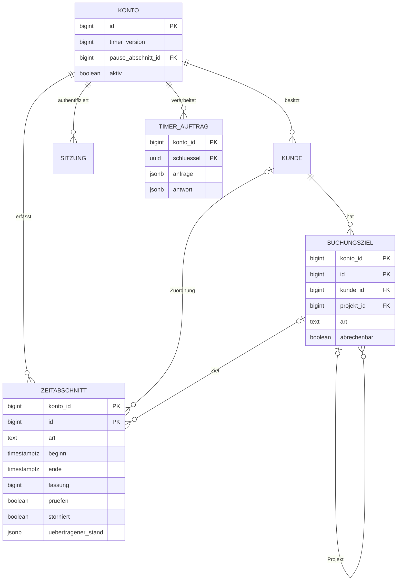

# Datenmodell

PostgreSQL ist für Timereal entschieden. Für eine Erstinstallation und für das ursprüngliche, noch nicht erweiterte Timereal-Grundmodell dient derselbe [Migrationseinstieg](datenmodell/entwurf.sql). Er lädt die versionierten SQL-Dateien relativ zu seinem Speicherort und serialisiert parallele Migrationen.

**Zeit und Zuordnung.** Ein persönlicher Abschnitt kann einem Ziel zugeordnet, vorläufig oder intern sein. Ein vorläufiger Abschnitt darf einen bekannten Kunden tragen. Interne Zeit hat weder Kunde noch Ziel und ist nicht abrechenbar. Ticket und Termin können ein Projekt desselben Kunden und Kontos referenzieren. Auf das Projekt selbst kann ebenfalls gebucht werden. Der Nachweis zählt einen Abschnitt einmal. Eine spätere Projektzuordnung wird beim Lesen berücksichtigt. Die früher bestätigte Projektbezeichnung bleibt im Übertragungsstand erhalten.

**Zeitgrenzen.** Gespeichert werden eindeutige Zeitpunkte in vollen Minuten. Ein offenes Ende kennzeichnet laufende Arbeit. Nicht stornierte Intervalle eines Kontos dürfen sich nicht überschneiden. Beim Wechsel berühren sich zwei Abschnitte an der halboffenen Grenze. Bei zwei Aktionen in derselben Minute kann ein abgeschlossener Abschnitt null Minuten haben. Pausen sind Lücken. Die zusätzliche Vormerkung im Konto ermöglicht Fortsetzen vom zweiten Gerät.

**Nachweis und Historie.** Eine Fassung schützt Änderungen an Abschnitt und Leistungstext. Die letzte bestätigte Übernahme speichert Zeitraum, Kunde, Projekt, Ziel, Text, Abrechenbarkeit und ausgegebene Dezimalstunden. Nach einer Änderung wird der damalige Stand mit dem aktuellen verglichen. Eine Änderung der eingestellten Ausgabepräzision kann eine erneute Prüfung auslösen. Die Nachkommastellen (zwei oder drei) verändern die gemessenen Minuten nicht. Ein alter Datensatz mit Übertragungsvermerk, aber ohne historischen Vollstand, erscheint zur erneuten Prüfung. Die Migration erfindet keinen früheren Leistungstext.

**Tageskorrektur.** Eine Unterbrechung 09:20–09:32 in einem Eintrag 09:00–10:00 erzeugt Abschnitte mit 20, 12 und 28 Minuten. Der Anfang behält seine ID und den gegebenenfalls bestätigten Stand von 60 Minuten. Die Folgeabschnitte haben eigene IDs. Bei der Korrektur gemeinsamer Grenzen werden die angrenzenden Zeiten in derselben Transaktion verschoben. Ein Storno erhält den ursprünglichen Eintrag in der Historie. Für eine früher übertragene Zeit bleibt die externe Rücknahme bis zur Bestätigung sichtbar.

**Kontotrennung und Sitzungen.** Datenbankschlüssel enthalten die Konto-ID. RLS schränkt die Dienstrolle pro Transaktion auf dieses Konto ein. Sitzungstabellen und Passworthashes haben eigene Zugriffsrechte. Eine Sperre schließt den aktiven Abschnitt, setzt die Prüfmarkierung, hebt die Pause auf und widerruft die Sitzungen gemeinsam.

Die [Integrationstests](tests/integration.mjs) prüfen diese Regeln mit echten Datenbankrollen und getrennten Verbindungen. Der [Browsertest](tests/browser.mjs) startet zwei getrennte Browsersitzungen für den Gerätewechsel.

## Kontozugänge ab 0.3.0

Migration 003 ergänzt die optionale eindeutige Konto-E-Mail und öffentliche Sitzungs-IDs, während Sitzungsschlüssel als Hash gespeichert bleiben. `kontolink` enthält Einladungen und Passwortzurücksetzungen mit Hash, Ablauf, Verbrauch und Widerruf. Diese Tabelle ist für die Anwendungsrolle nur über begrenzte Funktionen erreichbar. Verwaltungsfunktionen prüfen die aktive Administratorrolle; die bestehenden Zeittabellen behalten ihre Kontotrennung. Die Sitzungsanlage verwendet eine explizite Spaltenliste, damit die vorherige Anwendung nach der additiven Migration weiterlaufen kann.

## Ergänzung mit Version 0.4

Migration `004-arbeitsablauf.sql` ergänzt eine Fassung an Kunden und Buchungszielen. Änderungen im gemeinsamen Pflegeformular laufen in einer Transaktion; eine veraltete Kunden- oder Zielfassung verwirft den ganzen Speichervorgang. Historie und Woche lesen die bestehenden Zeitabschnitte. Die Woche schneidet Intervalle an den Tagesgrenzen der Kontozone und summiert die verstrichenen Minuten, nicht gerundete Stundenwerte.
