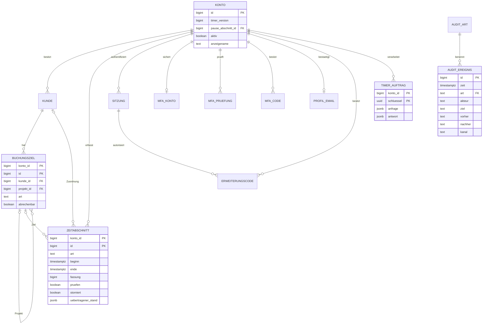

# Datenmodell

PostgreSQL ist für Timereal entschieden. Für eine Erstinstallation und für das ursprüngliche, noch nicht erweiterte Timereal-Grundmodell dient derselbe [Migrationseinstieg](datenmodell/entwurf.sql). Er lädt die versionierten SQL-Dateien relativ zu seinem Speicherort und serialisiert parallele Migrationen.

**Zeit und Zuordnung.** Ein persönlicher Abschnitt kann einem Ziel zugeordnet, vorläufig oder intern sein. Ein vorläufiger Abschnitt darf einen bekannten Kunden tragen. Interne Zeit hat weder Kunde noch Ziel und ist nicht abrechenbar. Ticket und Termin können ein Projekt desselben Kunden und Kontos referenzieren. Auf das Projekt selbst kann ebenfalls gebucht werden. Der Nachweis zählt einen Abschnitt einmal. Eine spätere Projektzuordnung wird beim Lesen berücksichtigt. Die früher bestätigte Projektbezeichnung bleibt im Übertragungsstand erhalten.

**Zeitgrenzen.** Gespeichert werden eindeutige Zeitpunkte in vollen Minuten. Ein offenes Ende kennzeichnet laufende Arbeit. Nicht stornierte Intervalle eines Kontos dürfen sich nicht überschneiden. Beim Wechsel berühren sich zwei Abschnitte an der halboffenen Grenze. Bei zwei Aktionen in derselben Minute kann ein abgeschlossener Abschnitt null Minuten haben. Pausen sind Lücken. Die zusätzliche Vormerkung im Konto ermöglicht Fortsetzen vom zweiten Gerät.

**Nachweis und Historie.** Eine Fassung schützt Änderungen an Abschnitt und Leistungstext. Die letzte bestätigte Übernahme speichert Zeitraum, Kunde, Projekt, Ziel, Text, Abrechenbarkeit und ausgegebene Dezimalstunden. Nach einer Änderung wird der damalige Stand mit dem aktuellen verglichen. Eine Änderung der eingestellten Ausgabepräzision kann eine erneute Prüfung auslösen. Die Nachkommastellen (zwei oder drei) verändern die gemessenen Minuten nicht. Ein alter Datensatz mit Übertragungsvermerk, aber ohne historischen Vollstand, erscheint zur erneuten Prüfung. Die Migration erfindet keinen früheren Leistungstext.

**Tageskorrektur.** Eine Unterbrechung 09:20–09:32 in einem Eintrag 09:00–10:00 erzeugt Abschnitte mit 20, 12 und 28 Minuten. Der Anfang behält seine ID und den gegebenenfalls bestätigten Stand von 60 Minuten. Die Folgeabschnitte haben eigene IDs. Bei der Korrektur gemeinsamer Grenzen werden die angrenzenden Zeiten in derselben Transaktion verschoben. Ein Storno erhält den ursprünglichen Eintrag in der Historie. Für eine früher übertragene Zeit bleibt die externe Rücknahme bis zur Bestätigung sichtbar.

**Kontotrennung und Sitzungen.** Datenbankschlüssel enthalten die Konto-ID. RLS schränkt die Dienstrolle pro Transaktion auf dieses Konto ein. Sitzungstabellen und Passworthashes haben eigene Zugriffsrechte. Eine Sperre schließt den aktiven Abschnitt, setzt die Prüfmarkierung, hebt die Pause auf und widerruft die Sitzungen gemeinsam.

Die [Integrationstests](tests/integration.mjs) prüfen diese Regeln mit echten Datenbankrollen und getrennten Verbindungen. Der [Browsertest](tests/browser.mjs) startet zwei getrennte Browsersitzungen für den Gerätewechsel.

## Mehrbenutzerbetrieb und Kapazität

`konto` bezeichnet einen eigenständigen Nutzer, keine einzelne Browserinstanz. Mehrere Nutzer werden seit dem Grundmodell berücksichtigt. Dieselbe Kundenbezeichnung darf in verschiedenen Konten vorkommen; eine gemeinsame Bearbeitung von Kunden oder Nachweisen durch ein Beraterteam ist damit nicht verbunden. Ein Administrator kann Zugänge verwalten, erhält dadurch aber keinen Zugriff auf deren Arbeitszeiten.

Die Planung für 100 gleichzeitig aktive Nutzer steht in [KAPAZITAET.md](KAPAZITAET.md). Der Lastlauf verwendet persönliche Sitzungen und die eingeschränkte Dienstrolle. Er prüft sowohl parallele Arbeit verschiedener Konten als auch die erneute Übermittlung desselben Timerauftrags. Eine Erhöhung der Nutzerzahl setzt die RLS- und Fremdschlüsselregeln nicht außer Kraft.

Migration `006-kapazitaet.sql` ergänzt Zugriffspfade für den laufenden Timer, das Ende abgeschlossener Abschnitte und Null-Minuten-Abschnitte. Der Timerindex sichert zusätzlich ausdrücklich einen offenen Abschnitt je Konto. Das Datenmodell erhält keine neue Nutzergrenze und keine fremden Freigaben. Bestehende Buchungen und Übertragungsstände werden durch diese Indexmigration nicht geändert. Der Updater führt sie bei angehaltenem Dienst aus; die benötigte Zeit wächst mit dem Datenbestand.

## Kontozugänge ab 0.3.0

Migration 003 ergänzt die optionale eindeutige Konto-E-Mail und öffentliche Sitzungs-IDs, während Sitzungsschlüssel als Hash gespeichert bleiben. `kontolink` enthält Einladungen und Passwortzurücksetzungen mit Hash, Ablauf, Verbrauch und Widerruf. Diese Tabelle ist für die Anwendungsrolle nur über begrenzte Funktionen erreichbar. Verwaltungsfunktionen prüfen die aktive Administratorrolle; die bestehenden Zeittabellen behalten ihre Kontotrennung. Die Sitzungsanlage verwendet eine explizite Spaltenliste, damit die vorherige Anwendung nach der additiven Migration weiterlaufen kann.

## Ergänzung mit Version 0.4

Migration `004-arbeitsablauf.sql` ergänzt eine Fassung an Kunden und Buchungszielen. Änderungen im gemeinsamen Pflegeformular laufen in einer Transaktion; eine veraltete Kunden- oder Zielfassung verwirft den ganzen Speichervorgang. Historie und Woche lesen die bestehenden Zeitabschnitte. Die Woche schneidet Intervalle an den Tagesgrenzen der Kontozone und summiert die verstrichenen Minuten, nicht gerundete Stundenwerte.

## Erweiterungszugang ab 0.5.0

Migration `005-erweiterung.sql` ergänzt `erweiterungscode` mit Code-Hash, Konto, autorisierender Websitzung, PKCE-Challenge, festem Rücksprungziel, Ablauf nach drei Minuten und Verbrauchszeitpunkt. Die Anwendungsrolle kann über RLS eigene Codes anlegen. Die begrenzte Funktion `erweiterung_anmelden` prüft Konto und Ursprungs-Websitzung, verbraucht den Code unter Sperre und legt eine Sitzung des Kanals `erweiterung` an. Doppelte Codeeinlösung, veraltete Websitzung, falscher Verifier und abweichendes Rücksprungziel ergeben keinen Zugang. Die Browsererweiterung schreibt in dieselben Zeitabschnitte wie die Web-App.

## Rollen ab 0.8.1

Migration 007 ergänzt `ist_betrieb` und die gespeicherte abgeleitete Spalte `rolle`. Die bestehende Eigenschaft `ist_admin` und die ältere Kontenlesefunktion bleiben kompatibel. Die Anwendungsrolle liest ihre eigene Rolle; Änderungen sind nur über die geprüfte Verwaltungsfunktion möglich. Kontensperre und Rollenwechsel erhalten eine gemeinsame Transaktionssperre vor der Sitzungsbindung. Dadurch wird eine parallel widerrufene Sitzung vor dem Schreiben erneut geprüft. Rollenwechsel widerrufen Sitzungen, ohne den Timer zu beenden. [Vertrag und Rechte](ROLLEN.md), [Prüfung](nachweise/0.8.1.md).

## Audit-Protokoll ab 0.8.2

Migration 008 ergänzt `audit_art` und `audit_ereignis`. Die Ereignisse halten Kontobezeichnungen zum Ereigniszeitpunkt als Text fest; sie sind keine Fremdschlüssel auf heutige Kontonamen. Trigger an Konto, Sitzung und Kontolink schreiben innerhalb der jeweiligen Transaktion. Für fehlgeschlagene Passwortanmeldungen meldet der Server ein gesondertes Ereignis, ohne unbekannte eingereichte Namen abzulegen.

Die Anwendungsrolle hat keine direkten Tabellenrechte. Die Lesefunktion prüft die aktive Administratorrolle, begrenzt den Zeitraum auf 180 Tage und verwendet ID-Cursor; der HTTP-Vertrag verlangt zusätzlich eine Websitzung. Änderungs-/Löschtrigger schützen vor gewöhnlichen SQL-Updates, ersetzen aber keine Kontrolle des Datenbankeigentümers. Die Migration ergänzt keine historischen Ereignisse. Aufbewahrung und Wartung sind getrennt vom Lesefenster zu entscheiden. [Daten- und Zugriffsvertrag](AUDIT.md).

## Kontosicherheit ab 0.9.0

Migration 009 ergänzt `mfa_konto` (verschlüsselter Faktor, Vorbereitung, letzter verbrauchter Zeitschritt, Revision und Fehlversuchsfenster), `mfa_pruefung` (Tokenhash, Revision, Ablauf) und `mfa_code` (Hash eines unbenutzten Wiederherstellungscodes). Die Funktionen sperren zuerst das aktive Konto; damit sind Abschluss, Wiederverwendung und paralleler Widerruf serialisiert. Die Anwendungsrolle besitzt keine direkten Tabellenrechte. Aktive Faktoren verhindern auch über die bisherige Funktion `sitzung_anlegen()` eine reine Passwortanmeldung.

Migration 010 ergänzt den optionalen Anzeigenamen und `profil_email` für die ausstehende E-Mail-Bestätigung. Ein Einmallink ist an das angemeldete Konto gebunden. Passwort-, Rollen- oder Sperränderungen entwerten ausstehende Faktorprüfungen, Einrichtungen und Adressbestätigungen, erhalten aber einen aktiven Faktor. Der Schlüssel liegt außerhalb der Datenbank; eine vollständige Sicherung benötigt deshalb Dump und zugehörige Schlüsseldatei. [Kontosicherheitsvertrag](KONTOSICHERHEIT.md).
