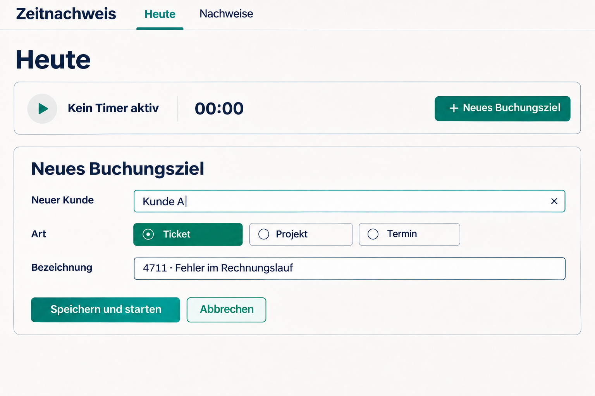
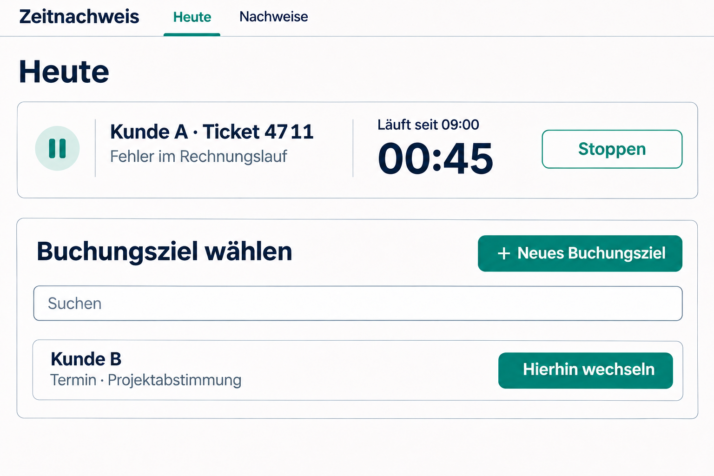
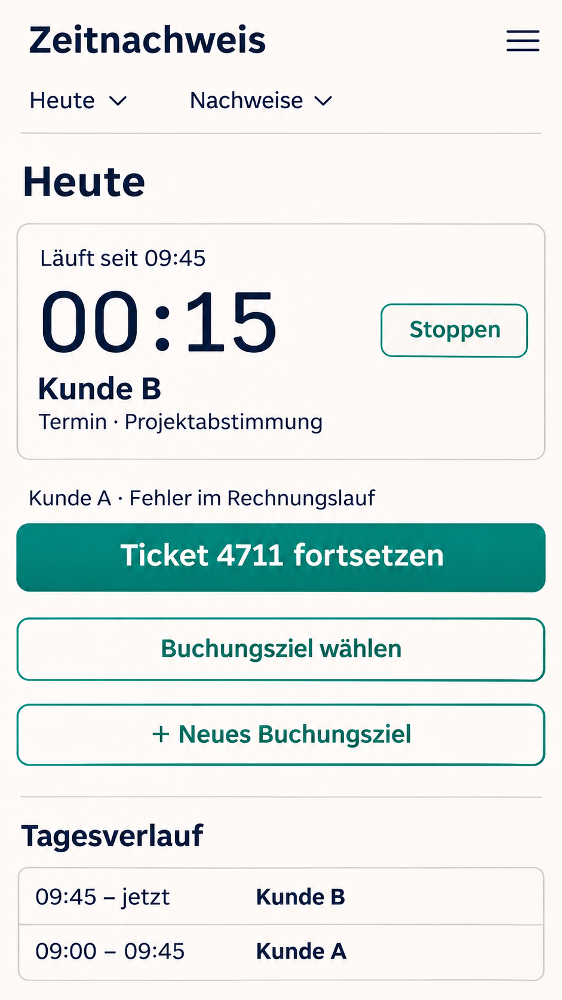
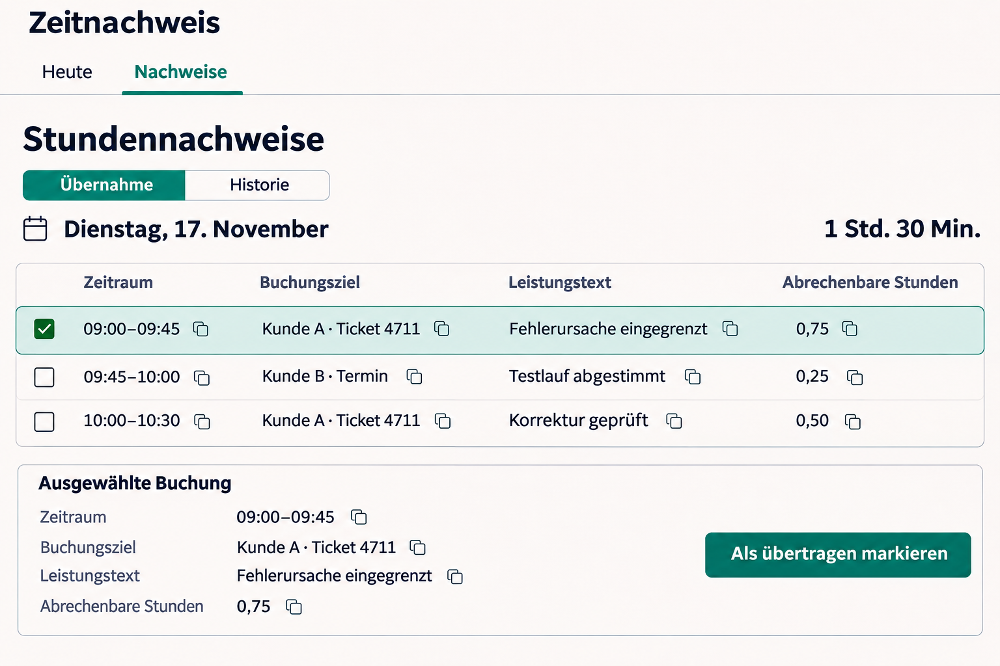
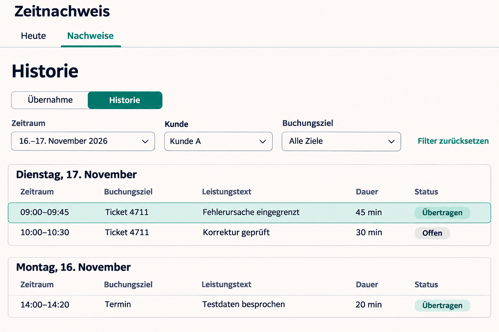
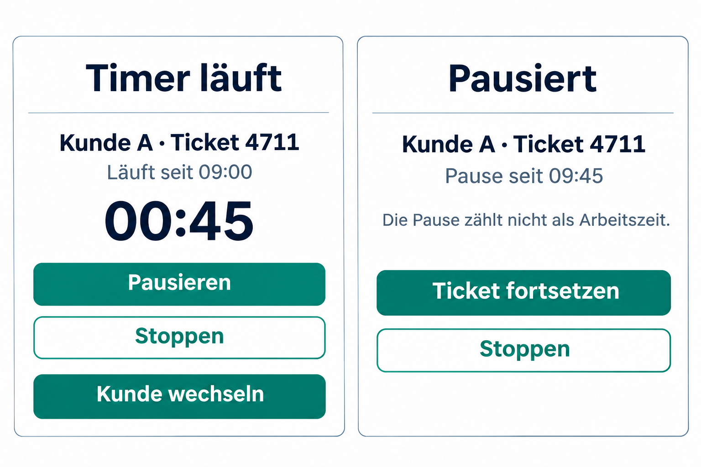
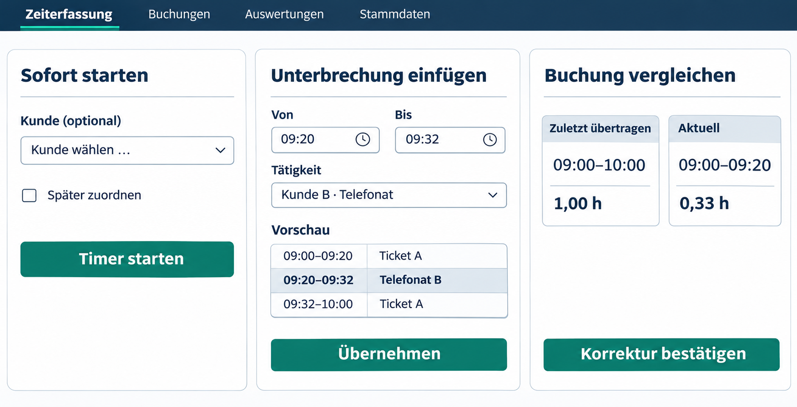

# Zeiterfassung für die Kundenarbeit

## Vom Kundenwechsel zum Stundennachweis

Du führst eine persönliche Liste mit Kunden und Buchungszielen. Ruft ein anderer Kunde an, schließt ein Klick den bisherigen Abschnitt und startet den nächsten zur selben Minute. Wenn du die frühere Arbeit fortsetzt, beginnt dafür ein eigener Abschnitt. So kannst du später auch ein kurzes Gespräch einzeln belegen.

## Im Browser arbeiten, auf Linux betreiben

Die erste Version läuft als Webanwendung auf einem Linux-Server. Du öffnest sie über eine HTTPS-Adresse im Browser, auch auf einem Linux-Laptop oder Smartphone. Eine lokale Installation auf den Arbeitsgeräten ist für die Nutzung entbehrlich. Der Backend-Dienst führt den persönlichen Timer zentral. Du kannst den Browser schließen und später auf einem anderen Gerät mit demselben Konto weiterarbeiten.

Für eine spätere Ausbaustufe ist eine Browsererweiterung vorgesehen. Sie soll denselben Funktionsumfang anbieten: Kunden und Buchungsziele anlegen, Zeiten starten, wechseln, stoppen, nachtragen und korrigieren, die Historie durchsuchen und Nachweise übernehmen. Der Schnellzugriff kann direkt im Erweiterungsfenster liegen, umfangreiche Ansichten auf einer eigenen Erweiterungsseite. Web-App und Erweiterung verwenden dieselbe authentifizierte Backend-Schnittstelle, dieselben Buchungen und denselben aktiven Timer. Der Zielbrowser für die Erweiterung wird beim Start dieser Ausbaustufe gewählt.

## Das erste Ticket am Laptop starten

Unter **Heute → + Neues Buchungsziel** erfasst du beim ersten Start den Kundennamen. Für weitere Ziele kannst du einen vorhandenen Kunden wählen oder einen neuen anlegen. Das Ziel hat eine Art (Ticket, Projekt oder Termin) und eine Bezeichnung. **Speichern und starten** legt das Ziel an und beginnt die Zeitmessung. Abbrechen verwirft die Eingabe.

## Während der Arbeit wechseln

Beim Anruf suchst du das Ziel des zweiten Kunden und wählst **Hierhin wechseln**. Während der Suche läuft der bisherige Timer weiter. Fehlt das Ziel, lässt es sich hier anlegen. In diesem Fall löst **Speichern und wechseln** den Wechsel aus. Ein Wechsel soll auf beiden Geräten denselben Stand hinterlassen, auch nach einem Doppeltipp.

## Nach dem Gespräch am Smartphone fortsetzen

**Ticket 4711 fortsetzen** schließt den Termin ab und öffnet einen neuen Abschnitt für das ursprüngliche Ticket. **Stoppen** beendet die Messung für eine Pause. Vergessene Abschnitte können im Tagesverlauf nachgetragen werden. Bei einer gemeinsam genutzten Zeitgrenze verschiebt eine Korrektur beide angrenzenden Abschnitte. Echte Pausen bleiben erhalten.

## Stundennachweise übertragen

Unter **Nachweise** stehen deine abrechenbaren Abschnitte einzeln zur manuellen Übernahme bereit. Du kopierst Zeitraum, Leistungstext und abrechenbare Stunden und markierst den Abschnitt nach der Eingabe in dein Abrechnungssystem als übertragen. Eine spätere Korrektur setzt den Status auf **Erneut prüfen**. Nicht abrechenbare Abschnitte bleiben im Tagesverlauf und in der Historie sichtbar.

Der Beispielvormittag umfasst 45 + 15 + 30 Minuten. Das ergibt unter **Abrechenbare Stunden** die Werte 0,75, 0,25 und 0,50. Die erfassten Minuten bleiben die Berechnungsgrundlage. Für die Übernahme sind zwei Nachkommastellen voreingestellt. Das Datenmodell unterstützt auch drei.

## Frühere Arbeitstage in der Historie nachschlagen

Unter **Nachweise → Historie** findest du deine abgeschlossenen Abschnitte, auch wenn sie schon übertragen wurden. Wähle einen Zeitraum und bei Bedarf einen Kunden oder ein Buchungsziel. Die Ergebnisliste ist nach Arbeitstag gruppiert, beginnend mit dem jüngsten Tag. Innerhalb eines Tages stehen die einzelnen Abschnitte in zeitlicher Reihenfolge mit Beginn, Ende, Buchungsziel, Leistungstext und Dauer. Zwei Einsätze für dasselbe Ticket bleiben zwei Zeilen. Über **Filter zurücksetzen** kehrst du von einer gefilterten Suche zur Ausgangsansicht zurück.

## Pause und Stopp

**Pausieren** schließt den Abschnitt und merkt das Ticket auch auf dem zweiten Gerät vor. **Fortsetzen** startet einen neuen Abschnitt. **Stoppen** beendet die Erfassung einschließlich einer vorhandenen Pausenvormerkung.

## Weitere Bedienabläufe im Entwurf

Die erste Testrunde konzentriert sich auf den laufenden Timer, den Gerätewechsel und den persönlichen Verlauf. PostgreSQL ist als Grundlage bestätigt. Der [technische Entwurf](ARCHITEKTUR.md) beschreibt den gemeinsamen Vertrag für Browser und Erweiterung.
