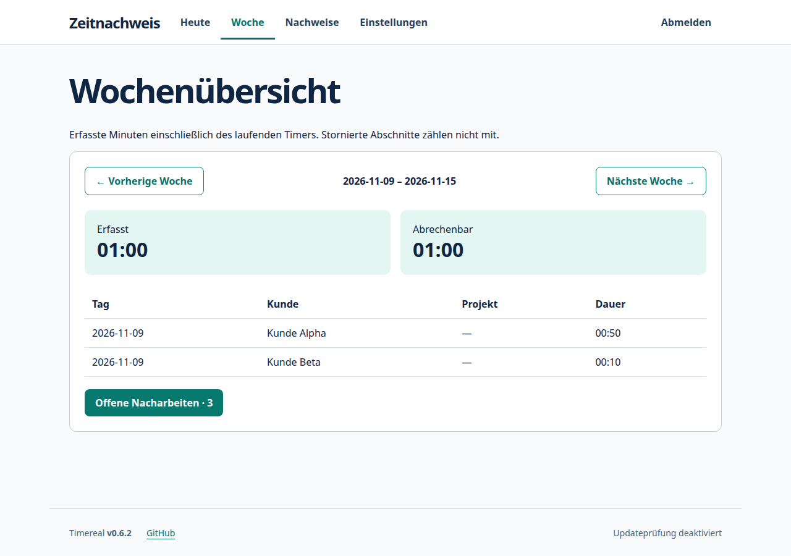
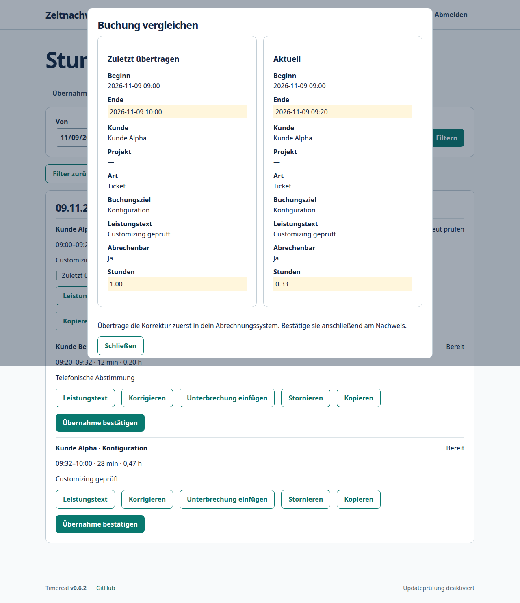
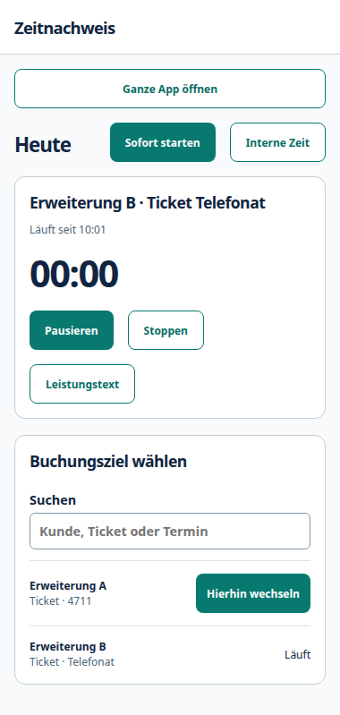

<h1 align="center">Timereal</h1>

<p align="center"><strong>Zeiten erfassen. Kunden wechseln. Nachweise vorbereiten.</strong><br>Deine Zeiterfassung im Browser – auf deinem eigenen Linux-Server.</p>

<p align="center">
  <a href="https://github.com/larsborgwardt/timereal/releases/latest"></a>
  <a href="https://github.com/larsborgwardt/timereal/actions/workflows/tests.yml?query=branch%3Afeature%2Fzeiterfassung-lxc"></a>
  <a href="LICENSE"></a>
</p>

<p align="center">
  <a href="#installation">Installation</a> ·
  <a href="#updates">Updates</a> ·
  <a href="#eigene-domain">Eigene Domain</a> ·
  <a href="#dokumentation">Dokumentation</a> ·
  <a href="https://github.com/larsborgwardt/timereal/issues">Fehler melden</a>
</p>

Timereal hilft Beratern und Selbstständigen, ihre Arbeit für verschiedene Kunden nachvollziehbar zu erfassen. Ein Kundenwechsel beendet den bisherigen Zeitabschnitt und startet den nächsten an derselben Zeitgrenze. Laptop, Smartphone und Browsererweiterung greifen auf den gemeinsamen Timer zu.

Die Daten liegen in deiner PostgreSQL-Datenbank. Stundennachweise lassen sich für die manuelle Übernahme in andere Systeme vorbereiten; eine direkte Anbindung an ein bestimmtes Abrechnungssystem ist nicht erforderlich.



*Echte Oberfläche aus dem Browsertest von Version 0.6.2, mit Testdaten.*

## Funktionen

| Für deinen Arbeitstag | In Timereal |
|---|---|
| Schnell anfangen | Sofortstart, interne Zeit und Buchungsziele für Kunden, Tickets oder Termine |
| Kunden wechseln | Gemeinsamer Timer über Geräte hinweg; Pause, Fortsetzen und Stopp |
| Zeiten vervollständigen | Leistungstexte, Nachträge, Korrekturen, Unterbrechungen und Stornos |
| Überblick behalten | Tagesverlauf, Wochenübersicht und durchsuchbare Historie |
| Stunden übertragen | Nachweise kopieren, Übernahme bestätigen und spätere Änderungen mit dem übertragenen Stand vergleichen |
| Weitere Berater einladen | Administrator-/Beraterrollen, Einladungen per E-Mail und Kontosperren; persönliche Kunden und Zeiten |
| Im Browser bleiben | Erweiterung für Chrome und Edge mit Timer und Notizen; eigene widerrufbare Sitzung |
| Selbst betreiben | Native Linux-Dienste, PostgreSQL, HTTPS, Sicherung vor Updates und Versionshinweis im Footer |

<details>
<summary><strong>Weitere Einblicke: Buchungsvergleich und Browsererweiterung</strong></summary>

### Änderungen vor der Übernahme vergleichen



### Timer in der Browserleiste



Die Bilder stammen aus der echten Anwendung mit Testkonten. Die [Erweiterungsanleitung](https://github.com/larsborgwardt/timereal/blob/v0.6.2/erweiterung/README.md) beschreibt Installation und Anmeldung.

</details>

## Installation

Der Installationsweg ist für einen **eigenen unprivilegierten Debian-13-LXC mit systemd** vorgesehen. Die Anwendung läuft mit Node.js, PostgreSQL und Caddy als native Dienste. Docker wird für diesen Installationsweg nicht benötigt.

| Einsatz | Startwerte |
|---|---|
| Persönlicher Pilot | 2 vCPU · 2 GiB RAM · 8 GiB Speicher |
| Planung für 100 gleichzeitig aktive Nutzer | 4 vCPU · 4 GiB RAM · 32 GiB SSD |

Der [Kapazitätsnachweis](https://github.com/larsborgwardt/timereal/blob/v0.6.2/KAPAZITAET.md) beschreibt Lastprofil, Messergebnisse und Grenzen. Die Werte sind keine Garantie für jede Hardware oder Datenmenge.

In der **Root-Konsole eines neuen Containers**:

```bash
apt-get update && apt-get install -y git ca-certificates &&
git clone --branch v0.6.2 --single-branch https://github.com/larsborgwardt/timereal.git /opt/timereal &&
bash /opt/timereal/betrieb/install.sh
```

Der Installer richtet die Dienste ein, fragt das erste Konto ab und zeigt die Browser-Adresse einschließlich Port, etwa `https://192.0.2.42:443`. Verwende die Adresse aus deiner eigenen Ausgabe.

- **443:** HTTPS-Zugang im Browser.
- **3040:** interner Anwendungsdienst auf Loopback, kein öffentlicher Zugang.
- **Lokales HTTPS:** Der Pilot verwendet eine eigene Zertifizierungsstelle. Übertrage nur das öffentliche Zertifikat `/root/timereal-test-ca.crt` über deinen vertrauten Containerzugang auf die Testgeräte und vertraue ihm dort für Websites. Auf dem iPhone zusätzlich das volle Vertrauen für das CA-Profil aktivieren.

SMTP, externe Sicherungen und weitere Installationshinweise stehen in der [Betriebsanleitung für 0.6.2](https://github.com/larsborgwardt/timereal/blob/v0.6.2/betrieb/README.md). Für eine vorhandene Installation verwende den Updateweg.

## Updates

Die Oberfläche zeigt die installierte Version und weist auf neue stabile Releases hin. **In 0.6.2 wird die Installation noch in der LXC-Konsole gestartet.**

Als root auf die veröffentlichte Version **0.6.2** aktualisieren:

```bash
git -C /opt/timereal fetch --tags origin &&
git -C /opt/timereal show v0.6.2:betrieb/update.sh > /root/timereal-update.sh &&
bash /root/timereal-update.sh --check v0.6.2 &&
bash /root/timereal-update.sh v0.6.2
```

Der Prüfmodus kontrolliert den Ausgangsstand. Das Update baut ein getrenntes Release und erstellt vor einer Datenbankänderung eine geprüfte Sicherung. Schlägt der neue Anwendungsstart fehl, versucht der Updater den vorherigen Anwendungsstand wieder zu starten. Eine alte Datenbanksicherung wird dabei nicht automatisch zurückgespielt.

[Release und Änderungsnotizen](https://github.com/larsborgwardt/timereal/releases/latest) · [Updatevertrag und Wiederherstellung](https://github.com/larsborgwardt/timereal/blob/v0.6.2/betrieb/README.md)

## Eigene Domain

Du kannst Timereal hinter deinem eigenen HTTPS-Reverse-Proxy betreiben. **Das Anwendungsupdate allein richtet die Domain noch nicht ein.** In 0.6.2 wird der folgende Einrichtungsschritt einmal im LXC ausgeführt.

Beispielwerte durch deine öffentliche Domain und Container-IP ersetzen:

```bash
bash /opt/timereal-current/betrieb/proxy-einrichten.sh --check zeit.example.org 192.0.2.42 &&
bash /opt/timereal-current/betrieb/proxy-einrichten.sh zeit.example.org 192.0.2.42
```

Der vorgeschaltete Proxy leitet auf **`https://CONTAINER_IP:443`** weiter und übergibt den öffentlichen Hostnamen. DNS, öffentliches Zertifikat und Routerweiterleitung müssen dazu passen. Bei aktivierter Upstream-Zertifikatsprüfung muss der Proxy der Timereal-Test-CA vertrauen.

Das Skript richtet den Hostnamen in Caddy und die öffentliche App-Adresse gemeinsam ein, sichert die bisherige Konfiguration und prüft HTTPS im Container. Prüfe danach die öffentliche Domain auch von außerhalb deines lokalen Netzes. Eine leere HTTP-200-Antwort ist kein erfolgreicher App-Aufruf.

[Reverse Proxy und direkter HTTPS-Betrieb](https://github.com/larsborgwardt/timereal/blob/v0.6.2/betrieb/README.md)

## Einen Arbeitstag ausprobieren

1. Unter **Heute → Neues Buchungsziel** Kunde und Ticket anlegen, dann **Speichern und starten**.
2. Auf dem Smartphone mit demselben Konto anmelden und zu einem anderen Kunden wechseln.
3. Das erste Ticket am Laptop fortsetzen. **Pausieren** merkt das Ziel vor; **Stoppen** beendet die Erfassung.
4. Leistungstext ergänzen und unter **Nachweise → Übernahme** in das externe System kopieren. Die erfolgte Übernahme bestätigen.
5. Korrekturen über **Buchung vergleichen** nachvollziehen; die Woche und Historie zum Abgleich nutzen.

## Geplant

**Noch nicht in 0.6.2 enthalten:** Updates direkt im Adminbereich sowie Domain-Einrichtung mit Prüfung und abgesichertem Wechsel über die Oberfläche. Dafür ist Version 0.7.0 vorgesehen. Die erste Einrichtung des Betriebsdienstes benötigt einmalig noch ein Konsolenupdate.

Später vorgemerkt sind differenzierte Rollen, Audit-Protokolle, ein Systemlog-Betrachter, Profilerweiterung und Zwei-Faktor-Anmeldung sowie der weitere Ausbau der Browsererweiterung. Der [aktuelle Backlog](https://github.com/larsborgwardt/timereal/blob/feature/zeiterfassung-lxc/BACKLOG.md) führt Umfang und Ausgangsstand.

## Dokumentation

Die folgenden Links zeigen den Stand des veröffentlichten Releases **0.6.2**:

| Thema | Einstieg |
|---|---|
| Installation, HTTPS, SMTP, Sicherung und Updates | [Betriebsanleitung](https://github.com/larsborgwardt/timereal/blob/v0.6.2/betrieb/README.md) |
| Versionen und Änderungen | [Changelog](https://github.com/larsborgwardt/timereal/blob/v0.6.2/CHANGELOG.md) |
| Architektur und Kundenwechsel | [Architektur](https://github.com/larsborgwardt/timereal/blob/v0.6.2/ARCHITEKTUR.md) |
| Datenbank | [Datenmodell](https://github.com/larsborgwardt/timereal/blob/v0.6.2/DATENMODELL.md) |
| Browsererweiterung | [Chrome/Edge einrichten](https://github.com/larsborgwardt/timereal/blob/v0.6.2/erweiterung/README.md) |
| Betrieb mit mehreren Nutzern | [Kapazitätsplanung](https://github.com/larsborgwardt/timereal/blob/v0.6.2/KAPAZITAET.md) |

## Entwicklung und Mitmachen

Für einen reproduzierbaren Einstieg das Release auschecken; laufende Änderungen sind in den [Pull Requests](https://github.com/larsborgwardt/timereal/pulls) sichtbar. Benötigt werden **Node.js 24** und **Docker** für die isolierte PostgreSQL-Testinstanz.

```bash
git clone --branch v0.6.2 https://github.com/larsborgwardt/timereal.git
cd timereal
npm ci
npm run build
npm test
```

Die Tests verwenden PostgreSQL 18; `POSTGRES_IMAGE=postgres:17-alpine npm test` prüft PostgreSQL 17. Für die Browser- und Erweiterungsproben:

```bash
npx playwright-core install chromium
BROWSER_TEST=1 npm test
```

Ein vorhandenes Chromium lässt sich mit `CHROMIUM_PATH` angeben. Die Tests legen eine getrennte Wegwerfdatenbank an.

Fehler und Vorschläge können als [GitHub-Issue](https://github.com/larsborgwardt/timereal/issues) eingereicht werden. Nenne Version, Installationsart und Schritte zum Nachstellen. Zugangsdaten und echte Kundendaten gehören nicht in öffentliche Issues. Besprich größere Funktionsänderungen vor einem Pull Request.

## Lizenz

Timereal wird unter der [GNU Affero General Public License v3](LICENSE) bereitgestellt.
